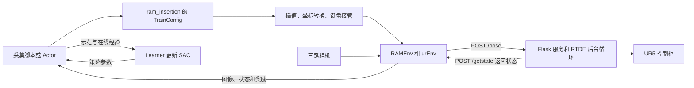

# UR5 固定 U 盘插接任务代码阅读指南

任务入口是 `ram_insertion`。六轴 UR5 带着刚性固定于法兰的 U 盘，对准充电头母口并插入。标准复位随机化机械臂的 XY 起点。第 8 节说明怎样用已有策略评估母口换位，并根据失败原因补充数据。

先读任务配置和复位流程，再看底层控制。读到策略训练时，你就能区分相机负责提供什么信息、谁决定机械臂怎么动、谁判定插入成功。

## 1. 从哪里开始读

| 顺序 | 打开文件 | 先弄清的问题 |
| --- | --- | --- |
| 1 | [任务注册表](examples/experiments/mappings.py#L1) | `--exp_name=ram_insertion` 选中的是什么？当前唯一注册项是 `ram_insertion`。 |
| 2 | [RAM 的 `EnvConfig` 和 `TrainConfig`](examples/experiments/ram_insertion/config.py#L51) | 目标在哪、相机有哪些、工作空间多大、成功依据是什么？ |
| 3 | [RAM 的 `reset()` 和 `go_to_reset()`](examples/experiments/ram_insertion/wrapper.py) | 启动采集与回合结束时，机械臂如何退出和回到起点？ |
| 4 | [基础环境的 `step()`](ur_env/envs/ur_env.py#L262) 和 [动作包装器](ur_env/envs/wrappers.py#L19) | 六维动作如何变成目标位姿？键盘接管在哪里替换策略动作？ |
| 5 | [机器人服务](serl_robot_ur/robot_servers/ur_server.py#L194) | Flask 接收目标后，后台如何读状态、执行位置伺服或力控？ |
| 6 | [示范采集](examples/record_demos.py#L74)、[分类器样本采集](examples/record_success_fail.py#L83) 和 [RLPD 训练](examples/train_rlpd.py#L438) | 两种数据各给谁使用？Actor 和 Learner 如何配合？ |



`RAMEnv` 是任务层，负责复位和任务流程。`urEnv` 是设备环境层，负责发位姿、读状态、取图和计算默认奖励。`serl_launcher` 是学习代码，负责策略网络、经验池与训练，理解机械臂为什么移动时可以先跳过它。

## 2. 先看任务配置，再看复位

这些是当前 [RAM 配置](examples/experiments/ram_insertion/config.py#L51) 中的程序值。现场安装位置、激活的 TCP 和设备编号需要以真机为准。

| 配置字段 | 当前值 | 如何理解 |
| --- | --- | --- |
| `TARGET_POSE` | `[0.0686, -0.6108, -0.2154, 2.9124, -1.1268, 0.0482]` | 基坐标系中的标称目标 TCP。前三项是米，后三项是旋转向量，单位弧度。 |
| `RESET_POSE` | `TARGET_POSE + [0, 0, 0.1, 0, 0, 0]` | 标称复位点在目标的基坐标系 +Z 方向 10 cm。 |
| `RANDOM_RESET` | `True` | 每次复位会在标称复位点的 X、Y 上各采样 ±3 cm，Z 使用复位高度。 |
| `RANDOM_RZ_RANGE` | `0.0001` rad | 随机分支在复位时读取的当前朝向上绕基座 Z 加微小扰动。 |
| `ABS_POSE_LIMIT_LOW/HIGH` | 以目标位姿为中心设上下界 | `step()` 会裁剪目标的 XYZ 和旋转向量分量。它约束这一条代码路径生成的目标 TCP。 |
| `ACTION_SCALE` | `(0.005, 0.005, 1)` | 底层动作的平移分量乘 `0.005 m`，旋转分量乘 `0.005 rad`。末项是预留夹爪量的缩放。 |
| `GRIPPER_ENABLED` | `False` | `urEnv._send_gripper_command()` 直接返回，`RAMEnv.regrasp()` 也会跳过。 |
| `POLICY_HZ` / `CONTROL_HZ` | `10` / `50` | 配置上每个策略步拆成 5 个控制子步。HTTP、相机与推理耗时决定实际频率。 |
| `COMPLIANCE_PARAM` / `PRECISION_PARAM` | 两套刚度、阻尼和误差截断参数 | `RAMEnv` 在任务与复位阶段向服务发送不同参数，力控循环据此计算力和力矩。 |

沿着 [RAMEnv.reset](examples/experiments/ram_insertion/wrapper.py) 能看到完整的回合起点。

1. 如果收到 `r` 请求，先处理重抓标记。现在夹爪关闭，重抓会跳过。
2. 调用 `_recover()` 访问 `/clearerr`，再进入 `go_to_reset()`。
3. 用 `PRECISION_PARAM`，将退出段目标设为当前 X/Y 和标称复位 Z。`joint_reset=True` 时还会请求 `/jointreset`。
4. 设置随机或固定复位点，移动完成后切回 `COMPLIANCE_PARAM`，清空步数并读取第一帧观测。

这里的 [interpolate_move](ur_env/envs/ur_env.py#L358) 用 `np.linspace` 生成位置与四元数的逐分量插值，再直接发 `/pose`。与 `step()` 的区别很重要。补查安全限制时，要分别看策略步、复位及自动轨迹这几条调用路径。采集与 Actor 都会调用真机 `reset()`，打开脚本阅读时尤其要分清 `fake_env=True` 和真实环境。

## 3. 跟踪一条动作和一帧观测

在 [TrainConfig.get_environment](examples/experiments/ram_insertion/config.py#L170) 中，包装器按从内到外的顺序构造。一次动作从外向内传递。

```text
ActionInterpolationWrapper → ChunkingWrapper → SERLObsWrapper → Quat2MrpWrapper
  → MrpToRotvecActionWrapper → RelativeFrame → KeyboardIntervention（真机）
  → GripperCloseEnv → RAMEnv / urEnv → POST /pose
```

| 读到的代码 | 这一层的工作 |
| --- | --- |
| [ActionInterpolationWrapper](ur_env/envs/wrappers.py#L19) | 把输入动作分为 5 个递增权重的子步，权重总和为 1，遇到回合结束就提前退出。 |
| [MrpToRotvecActionWrapper](ur_env/envs/wrappers.py#L223) | 把策略侧三个旋转动作分量从 MRP 参数转换成底层使用的旋转向量。MRP 是一种三参数的旋转表示。 |
| [RelativeFrame](ur_env/envs/relative_env.py#L39) | 使用当前 TCP 位姿算出的伴随矩阵把策略动作从末端系变到基坐标系。读取代码时留意这个版本使用完整的 `6×6` 矩阵，平移和旋转可能发生耦合。 |
| [KeyboardIntervention](ur_env/envs/wrappers.py#L542) | 人工接管时在 `RelativeFrame` 内侧替换动作，所以接管的平移按键对应基坐标系。`A/D` 对应 `+X/−X`，`W/S` 对应 `+Y/−Y`，`J/K` 对应 `+Z/−Z`。 |
| [GripperCloseEnv](ur_env/envs/wrappers.py#L370) | RAM 的无夹爪配置从策略到基础环境都使用 6 维末端动作。 |
| [urEnv.step](ur_env/envs/ur_env.py#L283) | 按比例换算平移和旋转增量，和当前位姿合成目标，按盒裁剪，再发 `/pose`。接着读取状态，计算奖励与回合状态。 |

插值层与键盘接管共享子步权重。采集时通过 `applied_action` 记录累计执行的动作，通过 `is_intervention` 标记这一策略步是否有人类接管。

观测从 `urEnv` 的 `{"images": ..., "state": ...}` 往外流。底层 TCP 是 `XYZ + 四元数 (qx, qy, qz, qw)`。`RelativeFrame` 可输出相对回合起点的位姿，`Quat2MrpWrapper` 把四元数变为三维 MRP，`SERLObsWrapper` 将五个本体字段展开，`ChunkingWrapper(obs_horizon=1)` 加上一维观测历史。策略的 `state` 因此是 `(1, 19)`，由 `tcp_pose` 6、`tcp_vel` 6、`tcp_force` 3、`tcp_torque` 3、`gripper_pose` 1 组成。无夹爪时最后一个字段仍是兼容占位。读取特定分量时查 `_flattened_state_index()`，不要按 `proprio_keys` 的书写顺序手算下标。见 [状态展开](serl_launcher/wrappers/serl_obs_wrappers.py#L5)、[历史堆叠](serl_launcher/wrappers/chunking.py#L34) 和 [索引计算](examples/experiments/ram_insertion/config.py#L25)。

| 图像键 | 当前 Linux 设备 | 用途 |
| --- | --- | --- |
| `global_1` | `/dev/video2` | 策略图像 |
| `wrist` | `/dev/video4` | 现场固定相机，策略与分类器输入 |
| `global_2` | `/dev/video0` | 现场腕部相机，策略与分类器输入 |

相机以配置的 `1280×720` 读取，通过 `IMAGE_CROP` 裁剪后缩放到 `128×128×3`。样本经历史堆叠后，每路图像带一维长度为 1 的历史。插值层将取图推迟到策略步的最后一个子步，或在提前结束回合时补取。排查取图可看 [get_im](ur_env/envs/ur_env.py#L391) 和 [V4LCapture](ur_env/camera/v4l_capture.py#L7)。

## 4. 机器人服务怎样控制机械臂

策略的输出始终是末端增量。到了服务端，`/pose` 接收的是已经合成的**目标末端位姿**。路由调用 `set_target_pose()` 更新目标缓存，RTDE 后台 `_run()` 周期性读取目标与反馈，再执行具体控制。这个版本的 `/getstate` 将平滑后的 TCP 位姿返回给 Gym 环境。见 [目标缓存](serl_robot_ur/robot_servers/ur_server.py#L383)、[反馈读取](serl_robot_ur/robot_servers/ur_server.py#L509) 和 [后台循环](serl_robot_ur/robot_servers/ur_server.py#L633)。

- `servo` 分支将目标位姿交给 RTDE `servoL`。仓库的 [无夹爪位置伺服脚本](serl_robot_ur/robot_servers/launch_ur_server_no_gripper_servo.sh) 配置 50 Hz。
- `forcemode` 分支以 100 Hz 运行，用目标与反馈之差、刚度及阻尼计算 wrench，即三轴力和三轴力矩，再调用 RTDE `forceMode`。`/update_param` 更新控制参数。工程里还有独立的 `/force_mode` 和 `/force_mode_stop` 路由供测试工具使用。见 [力矩计算](serl_robot_ur/robot_servers/ur_server.py#L614) 和 [力控路由](serl_robot_ur/robot_servers/ur_server.py#L1000)。
- `source="policy"` 会刷新力控目标的活动时间，也用于解除 `--start_paused_until_pose` 的启动暂停。正常 `step()` 发 `source="policy"`，复位插值发 `source="reset"`。遇到服务有目标但机械臂不动，先读这两个分支，再看相机或策略。见 [set_target_pose](serl_robot_ur/robot_servers/ur_server.py#L383)。

从项目根目录按现场已验证的控制模式启动服务。无夹爪力控脚本通过 `--force_mode_selection` 指定受力控的轴。真机启动参数见 [机器人服务说明](serl_robot_ur/README.md)。

## 5. 区分视觉输入、成功奖励和数据文件

真机 Actor 默认加载 RAM 的奖励分类器。采集入口构建基础环境时跳过分类器加载，基础环境可以按当前位置和目标的误差计算位姿奖励。实机评估以 U 盘完全插入为准。

`MAX_EPISODE_LENGTH=100`。外层插值把底层步数上限乘 5，约对应 10 秒标称控制时间。实际时长还受相机、网络和推理影响。达到步数上限时使用 `truncated` 标记超时。

| 数据 | 生产入口 | 保存在哪里和如何使用 |
| --- | --- | --- |
| 成功示范轨迹 | [record_demos.py](examples/record_demos.py#L74) | 相对当前目录的 `demo_data/ram_insertion_*demos*.pkl`。以成功回合为单位保留多步 transition，供 RLPD `--demo_path` 加载。 |
| 分类器正负样本 | [record_success_fail.py](examples/record_success_fail.py) | `classifier_data/` 下的 `*success_images*.pkl` 与 `*failure_images*.pkl`。训练使用人工明确标注的帧。 |
| 分类器模型 | [train_reward_classifier.py](examples/train_reward_classifier.py#L117) | 按完整回合或采集批次划分训练集与验证集，模型保存到 `classifier_ckpt/ram_insertion/`。 |
| 在线经验与策略检查点 | [train_rlpd.py](examples/train_rlpd.py#L234) | Actor 向 Learner 发送在线和人工干预经验。模型及数据快照使用 `--checkpoint_path` 指定的目录。 |

读一个 transition 时用 `observations → actions → next_observations` 的顺序理解动作前后，再检查 `rewards`、`dones` 和 `masks`。示范采集按 F 标成功、H 标失败、R 重置。正负样本标注、续采和保存格式见 [数据采集约定](examples/DATA_COLLECTION.md)。

视觉奖励使用 `wrist`、`global_2` 和本体状态，成功分数阈值为 `0.95`。运行真机 Actor 前准备 `classifier_ckpt/ram_insertion/` 下的分类器检查点。见 [RAM 分类器配置](examples/experiments/ram_insertion/config.py#L192)。

换位示范通过 `--manual_success_only` 保留人工确认完全插入的轨迹。固定母口的自动轨迹通过 `env.step()` 发送动作并沿用标称目标。见 [示范采集](examples/record_demos.py) 和 [auto_move_to_target](examples/auto_trajectory.py#L9)。

## 6. 最后读训练代码

1. 从 [train_rlpd.main](examples/train_rlpd.py#L438) 找 `CONFIG_MAPPING` 和 `config.get_environment()`。Learner 用 `fake_env=True` 取得动作与观测空间，Actor 使用真实环境。`single-arm-fixed-gripper` 这个名字选择普通的图像 SAC 网络，六维动作来自 `env.action_space.sample()`。
2. 看 [actor](examples/train_rlpd.py#L82) 如何取策略动作、调用 `env.step()`、处理干预，再将经验通过 TrainerClient 发给 Learner。当前干预由 `info["intervene_action"]` 识别，对应 transition 同时进入在线池与人工池。
3. 看 [learner](examples/train_rlpd.py#L317) 如何用 `actor_env` 对应的数据存储接收在线经验，用 `actor_env_intvn` 接收人工经验，再将 `--demo_path` 读入人工池。在线经验达到 `training_starts=200` 后开始更新。
4. 找 [对半采样](examples/train_rlpd.py#L363)。默认 batch 为 64，每批从在线池和人工池各取 32，再合并更新网络。想继续阅读网络实现，从 [make_sac_pixel_agent](serl_launcher/utils/launcher.py#L50) 进入 [SACAgent](serl_launcher/agents/continuous/sac.py)。图像经验池布局见 [MemoryEfficientReplayBuffer](serl_launcher/data/memory_efficient_replay_buffer.py#L12)。

示范会保存到当前工作目录的 `demo_data/`。用 `DEMO_DIR` 指定 Learner 应读取的示范目录，用 `CHECKPOINT_PATH` 指定 Learner 的检查点目录。Actor 通过 `--checkpoint_path` 指向同一目录。 [Learner 脚本](examples/experiments/ram_insertion/run_learner.sh) [Actor 脚本](examples/experiments/ram_insertion/run_actor.sh) [分类器脚本](examples/experiments/ram_insertion/run_reward_classifier.sh)

## 7. 带着问题回到代码

| 想搞清楚的问题 | 优先位置 |
| --- | --- |
| 我改了初始偏移，目标会跟着移动吗？ | `EnvConfig.TARGET_POSE` 和 `RAMEnv.go_to_reset()`。随机化发生在复位目标上，插入目标仍是固定坐标。 |
| 任务需要固定朝向，只比较位置偏差，从哪里看？ | `go_to_reset()` 中的 `current_rot` 与 `RANDOM_RZ_RANGE`。默认随机分支依赖当前朝向，复位姿态仍需要明确验证；策略仍有三个旋转动作。 |
| 画面丢帧或相机卡住，为什么移动慢？ | `urEnv.get_im()`、`V4LCapture.read()` 和插值子步。终端提示相机冻结时，`get_im()` 可能进入等待人工输入的恢复分支。 |
| `/pose` 请求失败，先查什么？ | 从 [pose 路由](serl_robot_ur/robot_servers/ur_server.py#L1048) 对应的服务日志和 `X-Request-ID` 查找原因，并检查 `/getstate` 中的安全状态。 |
| 怎样验证位置泛化？ | 保持母口位置验证机械臂起点泛化。使用同一套复位流程验证母口换位，并按工位记录实际插入成功率和失败类型。 |

第一次阅读可以在终端定位入口和调用链，这两条命令只读文件。

```bash
rg -n 'TARGET_POSE|RESET_POSE|RANDOM_|get_environment' examples/experiments/ram_insertion
rg -n 'def (step|compute_reward|_send_pos_command|set_target_pose|_run)' ur_env/envs serl_robot_ur/robot_servers/ur_server.py
```

看离线服务测试，先打开 [FakeArmBackend](tests/test_ur_server.py)，它用 Flask 测试客户端代替真机。仓库根目录的 `test_force_mode.py`、`test_force_z.py` 与真机调试有关，辨认入口时应先阅读 `main` 和参数解析。

## 8. 母口换位评估

使用同一套复位和旧策略，在原工位和已确认可达的新工位分别试验。母口和 U 盘保持插入朝向，母口在每次试验前固定。由策略从复位后的起点完成对准和插入。

在现场终端使用评估模式，指定同一个检查点并为各批次填写实际工位名。示例中的目录、步数和试验次数可按现场值调整。评估入口见 [Actor](examples/train_rlpd.py)。

```bash
MODE=eval EVAL_CHECKPOINT_STEP=25000 EVAL_N_TRAJS=1 \
bash examples/experiments/ram_insertion/run_actor.sh \
  --checkpoint_path="$PWD/examples/experiments/ram_insertion/first_run" \
  --eval_station=station_a
```

观察 U 盘实际状态，完全插入按 F，未完全插入按 H。程序分别计数人工确认的插入结果和分类器判定。换到另一个工位前，按现场流程让机械臂先退出并停稳。固定母口、改变机械臂起点的表现可作为原工位对照。

旧策略在新工位表现稳定时，可继续使用原检查点。分类器出现漏判或提前判成功时，补录对应图像。持续对不准时，给失败工位补人工示范，然后从原检查点的独立副本启动 Learner 和 Actor。验证泛化时，应将完整的新工位留到最后单独评估。 [采集与微调命令](examples/DATA_COLLECTION.md#母口换位示范与微调)
