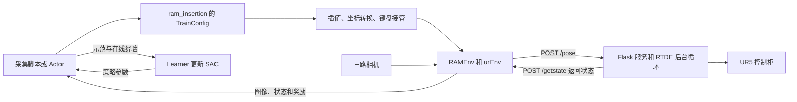

# UR5 固定 U 盘插接任务代码阅读指南

这份指南以当前工作区的提交 `177378e` 为准。任务入口是 `ram_insertion`，实际用途是让六轴 UR5 带着刚性固定在法兰上的 U 盘，对准固定的充电头母口并插入。在这个版本中，起点主要在 XY 平面变化，目标位姿固定。策略可以读取相机图像，默认成功判定使用 TCP 位姿。

先读任务配置和复位流程，再看底层控制。读到策略训练时，你就能区分相机负责提供什么信息、谁决定机械臂怎么动、谁判定插入成功。

## 1. 从哪里开始读

| 顺序 | 打开文件 | 先弄清的问题 |
| --- | --- | --- |
| 1 | [任务注册表](examples/experiments/mappings.py#L1) | `--exp_name=ram_insertion` 选中的是什么？当前唯一注册项是 `ram_insertion`。 |
| 2 | [RAM 的 `EnvConfig` 和 `TrainConfig`](examples/experiments/ram_insertion/config.py#L51) | 目标在哪、相机有哪些、工作空间多大、成功依据是什么？ |
| 3 | [RAM 的 `reset()` 和 `go_to_reset()`](examples/experiments/ram_insertion/wrapper.py#L44) | 启动采集与回合结束时，机械臂如何退出和回到起点？ |
| 4 | [基础环境的 `step()`](ur_env/envs/ur_env.py#L262) 和 [动作包装器](ur_env/envs/wrappers.py#L19) | 六维动作如何变成目标位姿？键盘接管在哪里替换策略动作？ |
| 5 | [机器人服务](serl_robot_ur/robot_servers/ur_server.py#L194) | Flask 接收目标后，后台如何读状态、执行位置伺服或力控？ |
| 6 | [示范采集](examples/record_demos.py#L74)、[分类器样本采集](examples/record_success_fail.py#L83) 和 [RLPD 训练](examples/train_rlpd.py#L438) | 两种数据各给谁使用？Actor 和 Learner 如何配合？ |



`RAMEnv` 是任务层，负责复位和任务流程。`urEnv` 是设备环境层，负责发位姿、读状态、取图和计算默认奖励。`serl_launcher` 是学习代码，负责策略网络、经验池与训练，理解机械臂为什么移动时可以先跳过它。

## 2. 先看任务配置，再看复位

这些是当前 [RAM 配置](examples/experiments/ram_insertion/config.py#L51) 中的程序值。现场安装位置、激活的 TCP 和设备编号需要以真机为准。

| 配置字段 | 当前值 | 如何理解 |
| --- | --- | --- |
| `TARGET_POSE` | `[0.1092, -0.6608, -0.2163, 2.9348, -1.0839, 0.0372]` | 基坐标系中的目标 TCP。前三项是米，后三项是旋转向量，单位弧度。 |
| `RESET_POSE` | `TARGET_POSE + [0, 0, 0.1, 0, 0, 0]` | 标称复位点在目标的基坐标系 +Z 方向 10 cm。 |
| `RANDOM_RESET` | `True` | 每次复位会在标称复位点的 X、Y 上各采样 ±3 cm，Z 使用复位高度。 |
| `RANDOM_RZ_RANGE` | `0.0001` rad | 随机分支在复位时读取的当前朝向上绕基座 Z 加微小扰动。 |
| `ABS_POSE_LIMIT_LOW/HIGH` | 以目标位姿为中心设上下界 | `step()` 会裁剪目标的 XYZ 和旋转向量分量。它约束这一条代码路径生成的目标 TCP。 |
| `ACTION_SCALE` | `(0.01, 0.01, 1)` | 底层动作的平移分量乘 `0.01 m`，旋转分量乘 `0.01 rad`。末项是预留夹爪量的缩放。 |
| `GRIPPER_ENABLED` | `False` | `urEnv._send_gripper_command()` 直接返回，`RAMEnv.regrasp()` 也会跳过。 |
| `POLICY_HZ` / `CONTROL_HZ` | `20` / `100` | 配置上每个策略步拆成 5 个控制子步。HTTP、相机与推理耗时决定实际频率。 |
| `COMPLIANCE_PARAM` / `PRECISION_PARAM` | 两套刚度、阻尼和误差截断参数 | `RAMEnv` 在任务与复位阶段向服务发送不同参数，力控循环据此计算力和力矩。 |

沿着 [RAMEnv.reset](examples/experiments/ram_insertion/wrapper.py#L142) 能看到完整的回合起点。

1. 如果收到 `r` 请求，先处理重抓标记。现在夹爪关闭，重抓会跳过。
2. 调用 `_recover()` 访问 `/clearerr`，再进入 `go_to_reset()`。
3. 用 `PRECISION_PARAM`，将退出段目标设为当前 X/Y 和标称复位 Z。`joint_reset=True` 时还会请求 `/jointreset`。
4. 设置随机或固定复位点，移动完成后切回 `COMPLIANCE_PARAM`，清空步数并读取第一帧观测。

这里的 [interpolate_move](ur_env/envs/ur_env.py#L358) 用 `np.linspace` 生成位置与四元数的逐分量插值，再直接发 `/pose`。与 `step()` 的区别很重要。补查安全限制时，要分别看策略步、复位及自动轨迹这几条调用路径。采集与 Actor 都会调用真机 `reset()`，打开脚本阅读时尤其要分清 `fake_env=True` 和真实环境。

## 3. 跟踪一条动作和一帧观测

在 [TrainConfig.get_environment](examples/experiments/ram_insertion/config.py#L170) 中，包装器按从内到外的顺序构造。一次动作从外向内传递。

```text
ActionInterpolationWrapper → ChunkingWrapper → SERLObsWrapper → Quat2MrpWrapper
  → MrpToRotvecActionWrapper → RelativeFrame → KeyboardIntervention（真机）
  → GripperCloseEnv → RAMEnv / urEnv → POST /pose
```

| 读到的代码 | 这一层的工作 |
| --- | --- |
| [ActionInterpolationWrapper](ur_env/envs/wrappers.py#L19) | 把输入动作分为 5 个递增权重的子步，权重总和为 1，遇到回合结束就提前退出。 |
| [MrpToRotvecActionWrapper](ur_env/envs/wrappers.py#L223) | 把策略侧三个旋转动作分量从 MRP 参数转换成底层使用的旋转向量。MRP 是一种三参数的旋转表示。 |
| [RelativeFrame](ur_env/envs/relative_env.py#L39) | 使用当前 TCP 位姿算出的伴随矩阵把策略动作从末端系变到基坐标系。读取代码时留意这个版本使用完整的 `6×6` 矩阵，平移和旋转可能发生耦合。 |
| [KeyboardIntervention](ur_env/envs/wrappers.py#L542) | 人工接管时在 `RelativeFrame` 内侧替换动作，所以接管的平移按键对应基坐标系。`A/D` 对应 `+X/−X`，`W/S` 对应 `+Y/−Y`，`J/K` 对应 `+Z/−Z`。 |
| [GripperCloseEnv](ur_env/envs/wrappers.py#L321) | 对上层暴露 6 维动作，对旧版底层补上第 7 维零值；结合 `GRIPPER_ENABLED=False`，底层跳过夹爪请求。 |
| [urEnv.step](ur_env/envs/ur_env.py#L262) | 按比例换算平移和旋转增量，和当前位姿合成目标，按盒裁剪，再发 `/pose`。接着通过 `/getstate` 读取状态和相机图像，计算奖励与回合状态。 |

读键盘速度时要注意，插值权重乘在上层输入上，而接管是在下层替换动作。当前接管量没有使用这一子步权重。读手动示范动作时也要注意，外层 `merged_info.update()` 会覆盖同名字段，最终的 `intervene_action` 不是逐子步累加的指令总量。

观测从 `urEnv` 的 `{"images": ..., "state": ...}` 往外流。底层 TCP 是 `XYZ + 四元数 (qx, qy, qz, qw)`。`RelativeFrame` 可输出相对回合起点的位姿，`Quat2MrpWrapper` 把四元数变为三维 MRP，`SERLObsWrapper` 将五个本体字段展开，`ChunkingWrapper(obs_horizon=1)` 加上一维观测历史。策略的 `state` 因此是 `(1, 19)`，由 `tcp_pose` 6、`tcp_vel` 6、`tcp_force` 3、`tcp_torque` 3、`gripper_pose` 1 组成。无夹爪时最后一个字段仍是兼容占位。读取特定分量时查 `_flattened_state_index()`，不要按 `proprio_keys` 的书写顺序手算下标。见 [状态展开](serl_launcher/wrappers/serl_obs_wrappers.py#L5)、[历史堆叠](serl_launcher/wrappers/chunking.py#L34) 和 [索引计算](examples/experiments/ram_insertion/config.py#L25)。

| 图像键 | 当前 Linux 设备 | 用途 |
| --- | --- | --- |
| `global_1` | `/dev/video2` | 策略图像 |
| `wrist` | `/dev/video4` | 策略图像，也是可选分类器输入 |
| `global_2` | `/dev/video0` | 策略图像，也是可选分类器输入 |

相机以配置的 `1280×720` 读取，通过 `IMAGE_CROP` 对各路图像裁剪，随后调整成 `128×128×3`。样本经历史堆叠后，每路图像带一维长度为 1 的历史。相机初始化按 `video_device` 进入 `V4LCapture`，底层 `step()` 每个子步都会取图。排查卡顿时可看 [get_im](ur_env/envs/ur_env.py#L316) 和 [V4LCapture](ur_env/camera/v4l_capture.py#L7)。

## 4. 机器人服务怎样控制机械臂

策略的输出始终是末端增量。到了服务端，`/pose` 接收的是已经合成的**目标末端位姿**。路由调用 `set_target_pose()` 更新目标缓存，RTDE 后台 `_run()` 周期性读取目标与反馈，再执行具体控制。这个版本的 `/getstate` 将平滑后的 TCP 位姿返回给 Gym 环境。见 [目标缓存](serl_robot_ur/robot_servers/ur_server.py#L383)、[反馈读取](serl_robot_ur/robot_servers/ur_server.py#L509) 和 [后台循环](serl_robot_ur/robot_servers/ur_server.py#L633)。

- `servo` 分支将目标位姿交给 RTDE `servoL`。仓库的 [无夹爪位置伺服脚本](serl_robot_ur/robot_servers/launch_ur_server_no_gripper_servo.sh) 配置 50 Hz。
- `forcemode` 分支以 100 Hz 运行，用目标与反馈之差、刚度及阻尼计算 wrench，即三轴力和三轴力矩，再调用 RTDE `forceMode`。`/update_param` 更新控制参数。工程里还有独立的 `/force_mode` 和 `/force_mode_stop` 路由供测试工具使用。见 [力矩计算](serl_robot_ur/robot_servers/ur_server.py#L614) 和 [力控路由](serl_robot_ur/robot_servers/ur_server.py#L1000)。
- `source="policy"` 会刷新力控目标的活动时间，也用于解除 `--start_paused_until_pose` 的启动暂停。正常 `step()` 发 `source="policy"`，复位插值发 `source="reset"`。遇到服务有目标但机械臂不动，先读这两个分支，再看相机或策略。见 [set_target_pose](serl_robot_ur/robot_servers/ur_server.py#L383)。

**当前版本有一处可静态确认的启动脚本差异。** [无夹爪力控脚本](serl_robot_ur/robot_servers/launch_ur_server_no_gripper_forcemode.sh#L13) 传入 `--force_mode_selection`，而同版本 [服务端参数列表](serl_robot_ur/robot_servers/ur_server.py#L1022) 未注册该参数。若终端提示 `unrecognized arguments`，应核对脚本和服务端版本。轴选择会影响力控行为，现场使用前要确认实际加载的设置。直接运行 `ur_server.py` 的默认模式是 `forcemode`，启动入口需要明确区分。

## 5. 区分视觉输入、成功奖励和数据文件

**当前 RAM 的相机参与策略观测，默认奖励由位姿决定。** [compute_reward](ur_env/envs/ur_env.py#L297) 检查当前位置每轴误差是否小于 5 mm，以及相对旋转向量各分量是否小于 `0.02 rad`。达标返回 1，否则返回 0。固定目标坐标和阈值可用来判定是否到达标称区域，USB 插接是否到位仍需要现场验证。

`MAX_EPISODE_LENGTH=100`，外层插值为保留策略步口径将底层步数上限乘 5，因此约对应 5 秒的标称控制时间。实际墙钟时长还受相机和网络影响。这个版本的底层把步数上限也放进 `done`，并固定返回 `truncated=False`。排查回合很短或 `masks` 不符合预期时，要一起看策略步和底层子步的计数口径。见 [底层终止条件](ur_env/envs/ur_env.py#L285) 和 [插值计数](ur_env/envs/wrappers.py#L54)。

| 数据 | 生产入口 | 保存在哪里和如何使用 |
| --- | --- | --- |
| 成功示范轨迹 | [record_demos.py](examples/record_demos.py#L74) | 相对当前目录的 `demo_data/ram_insertion_*demos*.pkl`。以成功回合为单位保留多步 transition，供 RLPD `--demo_path` 加载。 |
| 分类器正负样本 | [record_success_fail.py](examples/record_success_fail.py#L83) | `classifier_data/` 下的 `*success_images*.pkl` 与 `*failure_images*.pkl`，供奖励分类器训练。当前手动流程以空格标正样本，普通未标帧会进入负类。 |
| 分类器模型 | [train_reward_classifier.py](examples/train_reward_classifier.py#L117) | 从当前目录的 `classifier_data/` 加载，默认以终止样本、动作后观测为主，按正负类分开随机划分样本，模型保存到 `classifier_ckpt/`。 |
| 在线经验与策略检查点 | [train_rlpd.py](examples/train_rlpd.py#L234) | Actor 向 Learner 发送在线和人工干预经验。模型及数据快照使用 `--checkpoint_path` 指定的目录。 |

读一个 transition 时用 `observations → actions → next_observations` 的顺序理解动作前后，再检查 `rewards`、`dones` 和 `masks`。在示范采集脚本里，`infos.succeed` 决定整条轨迹是否保存。按 `F` 会修改 `succeed` 和 `done`，写盘的 `rewards` 仍使用 `env.step()` 返回值。`G` 在示范脚本里标失败，在内层键盘包装器里也会切换坐标追点，排查按键时要同时看两处回调。开启 `--resume` 会加载旧数据并继续累计。该版本退出保存新文件，整理数据目录时要避免重复读入多份重叠快照。见 [采集热键](examples/record_demos.py#L82) 和 [键盘回调](ur_env/envs/wrappers.py#L590)。

可选视觉奖励需要同时满足 `get_environment(classifier=True)` 和 `EnvConfig.ENABLE_CLASSIFIER_REWARD=True`。后者目前是 `False`，所以即使已训练分类器，默认 Actor 仍用位姿阈值。启用分支使用 `wrist`、`global_2`，成功分数阈值 `0.95`。当前分类器网络还读取本体状态，训练验证是按样本而非完整回合划分。判断视觉泛化前应检查这些条件。见 [分类器启用分支](examples/experiments/ram_insertion/config.py#L191) 和 [网络输入](serl_launcher/networks/reward_classifier.py#L47)。

**训练前先核对旧样本格式。** 分类器训练的 `_normalize_classifier_obs()` 查找嵌套的 `obs["images"]`，而手动采集经 `SERLObsWrapper` 后，图像键在观测顶层。这类样本可能被跳过。默认 `--terminal_only` 也会过滤未终止的负样本。出现 `No positive/negative classifier samples` 时，先检查观测结构和 `dones`，再查网络。见 [训练数据准备](examples/train_reward_classifier.py#L40) 和 [观测包装](serl_launcher/wrappers/serl_obs_wrappers.py#L25)。

`--auto` 要单独看。[auto_move_to_target](examples/auto_trajectory.py#L52) 会直接按坐标发送插值位姿，绕过策略增量包装器。这个版本的自动轨迹用全零动作占位，图像和历史维的布局也与策略的正常观测不同。应先逐字段核对数据，再将其用于训练。自动到点结果也应与人工确认的实际插接结果分别看待。

## 6. 最后读训练代码

1. 从 [train_rlpd.main](examples/train_rlpd.py#L438) 找 `CONFIG_MAPPING` 和 `config.get_environment()`。Learner 用 `fake_env=True` 取得动作与观测空间，Actor 使用真实环境。`single-arm-fixed-gripper` 这个名字选择普通的图像 SAC 网络，六维动作来自 `env.action_space.sample()`。
2. 看 [actor](examples/train_rlpd.py#L82) 如何取策略动作、调用 `env.step()`、处理干预，再将经验通过 TrainerClient 发给 Learner。当前干预由 `info["intervene_action"]` 识别，对应 transition 同时进入在线池与人工池。
3. 看 [learner](examples/train_rlpd.py#L317) 如何用 `actor_env` 对应的数据存储接收在线经验，用 `actor_env_intvn` 接收人工经验，再将 `--demo_path` 读入人工池。在线经验达到 `training_starts=200` 后开始更新。
4. 找 [对半采样](examples/train_rlpd.py#L363)。默认 batch 为 64，每批从在线池和人工池各取 32，再合并更新网络。想继续阅读网络实现，从 [make_sac_pixel_agent](serl_launcher/utils/launcher.py#L50) 进入 [SACAgent](serl_launcher/agents/continuous/sac.py)。图像经验池布局见 [MemoryEfficientReplayBuffer](serl_launcher/data/memory_efficient_replay_buffer.py#L12)。

比较 [Learner 脚本](examples/experiments/ram_insertion/run_learner.sh)、[Actor 脚本](examples/experiments/ram_insertion/run_actor.sh) 和 [分类器脚本](examples/experiments/ram_insertion/run_reward_classifier.sh) 时，优先看硬编码路径。示范保存到进程当前目录的 `demo_data/`，旧 Learner 脚本读的是固定的 `examples/demo_data/`。Actor 的 `first_run` 是相对路径，Learner 使用绝对路径。目录不一致时，先核对启动位置和参数再排查算法。

## 7. 带着问题回到代码

| 想搞清楚的问题 | 优先位置 |
| --- | --- |
| 我改了初始偏移，目标会跟着移动吗？ | `EnvConfig.TARGET_POSE` 和 `RAMEnv.go_to_reset()`。随机化发生在复位目标上，插入目标仍是固定坐标。 |
| 任务需要固定朝向，只比较位置偏差，从哪里看？ | `go_to_reset()` 中的 `current_rot` 与 `RANDOM_RZ_RANGE`。默认随机分支依赖当前朝向，复位姿态仍需要明确验证；策略仍有三个旋转动作。 |
| 画面丢帧或相机卡住，为什么移动慢？ | `urEnv.get_im()`、`V4LCapture.read()` 和插值子步。终端提示相机冻结时，`get_im()` 可能进入等待人工输入的恢复分支。 |
| `/pose` 返回 500，先查什么？ | 先查 [pose 路由](serl_robot_ur/robot_servers/ur_server.py#L796) 周围的服务日志与 `X-Request-ID`。当前 `_send_pos_command()` 只发请求，未调用 `raise_for_status()`。读历史日志时应先确认脚本对应的提交。 |
| 怎样验证位置泛化？ | 用已标定的固定母口和一致的起始朝向，在工作区内设置一批训练未见过的 XY 偏移。按不同方向和幅度记录真实插入成功率、是否人工接管及失败类型。当前复位不会主动随机 Z，也不会移动母口。 |

第一次阅读可以在终端定位入口和调用链，这两条命令只读文件。

```bash
rg -n 'TARGET_POSE|RESET_POSE|RANDOM_|get_environment' examples/experiments/ram_insertion
rg -n 'def (step|compute_reward|_send_pos_command|set_target_pose|_run)' ur_env/envs serl_robot_ur/robot_servers/ur_server.py
```

看离线服务测试，先打开 [FakeArmBackend](tests/test_ur_server.py)，它用 Flask 测试客户端代替真机。仓库根目录的 `test_force_mode.py`、`test_force_z.py` 与真机调试有关，辨认入口时应先阅读 `main` 和参数解析。

## 8. 母口换位置时的双相机对准

填写 `RAM_PORT_VISION_CONFIG` 后，`ram_insertion` 的回合开始会接入双相机对准。固定相机在原始图里找充电头的模板特征，估计这次可插入时的基座 TCP XY。机械臂到达接近高度后，腕部相机比较母口图像与参考图，求小幅 XY 修正。对准后更新 `_TARGET_POSE` 和 `resetpos`，既有六维策略随后使用真实对准位置的图像和本体状态完成插入。定位失败会终止本轮，服务收到 `/hold` 时暂停发送运动。见 [定位器](examples/experiments/ram_insertion/port_vision.py)、[对准流程](examples/experiments/ram_insertion/port_approach.py) 和 [RAMEnv 接入点](examples/experiments/ram_insertion/wrapper.py)。

首版标定覆盖同一高度、同一朝向的 XY 摆放。用当前装置已经验证的插入 TCP 和接近高度作为参照，核对所有采样位置及接近路径处于已验证的工作空间内。配置模板的 `null` 位置需要填现场测量值。见 [标定输入模板](examples/experiments/ram_insertion/port_vision.example.json)。

1. **采集固定相机样本。** 使用能看全摆放区域的机位，默认 `global_2`。在至少四个不共线的母口摆放点记录同一模板特征的像素中心 `pixel_xy`，以及对应该母口的可插入 TCP `base_xy_m`。所有像素坐标都基于相机原始帧。多于四个位置便于检查拟合误差。
2. **采集腕部相机样本。** 母口保持在一个固定位置。在标称朝向、已验证的接近高度记录正确对准时的腕部原图和 `reference_tcp_xy_m`。保持同一高度和朝向，在 X/Y 方向做小位移，记录这些位置的实际 `tcp_xy_m` 和同一视觉特征的 `pixel_xy`。`approach_z_m` 填入本次腕部采样的基座 Z，需位于 RAM 标称复位高度与工作空间上界之间。
3. **准备原始图与框。** 两路 `image` 是各自的参考原图。`template_roi` 是原图中的特征裁框，`roi` 是运行时搜索范围，两者都按 `[x,y,width,height]` 写。参考像素取模板中心。对准使用原图分辨率，因而校准时保存的图需和真实运行图像尺寸一致。固定相机模板可取容易辨认的外壳区域，腕部模板尽量包含能辨认母口位置的局部特征。

在 Linux 项目根目录准备测量文件，使用 [标定工具](examples/calibrate_ram_port_vision.py) 生成部署 JSON 和两张模板 PNG。`fit` 和 `inspect` 只访问图像文件。`capture` 可从对应相机保存原图，使用时应先释放其它程序占用的该路相机。

```bash
cp examples/experiments/ram_insertion/port_vision.example.json port_measurements.json
# 填写 port_measurements.json。示例图像路径和坐标需替换成现场数据。
python examples/calibrate_ram_port_vision.py fit --measurements port_measurements.json --output port_vision.json
python examples/calibrate_ram_port_vision.py inspect --config port_vision.json --fixed-image fixed_test.png --wrist-image wrist_test.png
```

把生成的 JSON 和模板 PNG 放在同一个标定目录。先在不同已知位置的图片上检查 `inspect` 的固定相机 XY 是否接近实测值，并确认腕部 XY 修正方向正确。部署到真机后，先用同一提交的 UR 服务和已经验证的复位高度。机械臂停在该高度或更高、朝向已对准时，可用下列入口试一次粗定位和腕部精对准。它会等待终端 `U` 键确认母口固定，然后移动到母口上方并停止在接近高度。

```bash
python examples/check_ram_port_approach.py --config port_vision.json
```

对准试跑通过后，用原有 Actor 或采集入口和实际检查点。给该终端设置 `RAM_PORT_VISION_CONFIG`，每轮先退出，再按 `U` 继续。Learner 的假环境仍用于构建原有观测和动作空间。人工采集用真实插接示范，评估时以实际完全插入为准，当前位姿奖励仅反映检测目标附近的位姿。`RAM_CHECKPOINT_DIR` 和 `RAM_CHECKPOINT_STEP` 由现场使用的检查点决定。

```bash
export RAM_PORT_VISION_CONFIG="$PWD/port_vision.json"
python examples/train_rlpd.py --exp_name=ram_insertion --actor \
  --checkpoint_path="$RAM_CHECKPOINT_DIR" --eval_checkpoint_step="$RAM_CHECKPOINT_STEP" --eval_n_trajs=1
```
