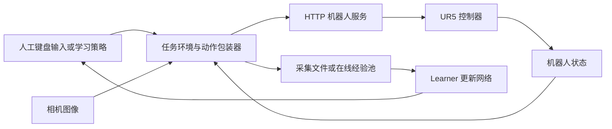

# UR5 插接项目：从哪里开始读

这个项目让 UR5 通过相机图像和机器人状态学习插接动作。Python 文件中的中文注释分成三层：文件开头介绍模块用途和术语；语句前的“逐行”说明解释具体操作；关键算法与控制段落还补充了整段代码之间的关系。

原来的英文文档字符串、日志内容和代码保留。多行字符串内部没有插入注释，避免改变程序实际使用的文本。Shell 命令的反斜杠续行说明集中写在命令前，避免破坏启动命令。

## 先理解一条真实运行链路



## 按这个顺序读代码

| 顺序 | 文件 | 先搞懂什么 |
|---|---|---|
| 1 | `examples/experiments/usb_insertion/config.py` | 相机、动作缩放、复位、运动边界、奖励分类器，以及环境包装顺序 |
| 2 | `examples/record_demos.py` | 一条成功示范如何从键盘操作变成连续经验记录 |
| 3 | `examples/collection_utils.py` | 状态、动作、奖励、下一状态、回合边界怎样组织与保存 |
| 4 | `examples/record_success_fail.py` | 分类器样本如何采集、人工标签怎样生成 |
| 5 | `ur_env/envs/ur_env.py` | `reset()`、`step()`、图像读取和 HTTP 命令如何协同 |
| 6 | `ur_env/envs/wrappers.py`、`relative_env.py` | 动作插值、人工接管、坐标变换和旋转表示 |
| 7 | `serl_robot_ur/robot_servers/ur_server.py` | HTTP 接口如何连接 RTDE，以及后台线程如何跟随目标 |
| 8 | `examples/train_reward_classifier.py` | 已标注样本如何用于训练成功检测器 |
| 9 | `examples/train_rlpd.py` | Actor 收集经验、Learner 更新参数，以及两者如何通信 |
| 10 | `serl_launcher/agents/continuous/sac.py` | 策略网络、价值网络、温度与目标网络怎样一起更新 |
| 11 | `serl_launcher/data/`、`networks/`、`vision/` | 经验池、神经网络结构、图像编码和数据增强 |
| 12 | `tests/test_collection.py`、`test_classifier_reward.py`、`test_camera_step_timing.py` | 用假输入说明各项行为应该满足什么条件 |

RAM 任务从 `examples/experiments/ram_insertion/config.py` 进入，其配置和 USB 任务分开。两个任务共享不少环境与学习代码。

## 初学者容易混淆的概念

| 概念 | 在本项目中是什么意思 |
|---|---|
| 六自由度 UR5 | 机械臂有六个关节；夹爪是额外的末端设备 |
| TCP | 工具中心点，需要与实际固定 U 盘的工具设置一致 |
| 位姿 pose | 位置与朝向的组合；七维位姿并不表示机械臂有七个关节 |
| xyz + rotvec | 三个位置分量，加三个旋转向量分量；位置通常是米，旋转向量模长是弧度角 |
| xyz + quat | 三个位置分量，加四个四元数分量；环境常用四元数顺序 xyzw |
| MRP | 用三个数表示朝向的另一种方式；不能把这三个数当成欧拉角 |
| action | 策略空间中的动作；经缩放与坐标变换后才成为下层运动命令 |
| observation | 相机图像和机器人状态；包装器会改变它的结构与表示 |
| transition | 一步交互：动作前观测、动作、奖励、动作后观测、结束信息 |
| trajectory / episode | 从复位开始，到成功、停止或超时为止的一整段交互 |
| Actor | 执行策略并收集实际经验的进程，也可指输出动作的策略网络，需看上下文 |
| Learner | 从经验中取训练批次、计算损失和更新网络的进程 |
| Critic / Q | 估计一个状态下采取某个动作能带来多少后续奖励 |
| Replay buffer | 保存过去经验并随机抽样，避免只根据最新一步训练 |
| reward classifier | 预测成功概率并提供奖励的学习模型；当前实现也读取机器人状态 |
| checkpoint | 保存的模型或训练状态，用于恢复与评估 |
| terminated | 任务成功或主动停止等正常终止条件成立 |
| truncated | 因步数上限等外部限制结束当前回合 |
| dones | 经验存储中的回合边界标记，可覆盖正常终止和超时 |
| masks | 是否还需要估计下一状态价值；本项目对正常终止和超时分别处理 |
| JAX 随机密钥 | 把随机过程显式作为输入；每次拆分密钥，减少意外复用同一随机序列 |
| 梯度 gradient | 表示损失对参数变化的敏感程度，优化器据此调整网络参数 |

图像数组常用“高、宽、通道”的顺序；图像裁剪 `img[y1:y2, x1:x2]` 先写行 y，再写列 x。当前任务包装后还会保留长度为 1 的时间维，因此图像形状常见为 `(1, 128, 128, 3)`。

`state` 的扁平顺序由 Gym 字典空间及其 flatten 规则决定，不应仅凭配置列表顺序手工猜测索引。任务配置里的标记值方法就是用来推导实际索引的。

## 怎样读一个函数

1. 先看参数来自哪里，例如 `env.step(action)` 的 action 是策略还是人工操作。
2. 找到输入经过的单位换算、坐标变换和形状变化。
3. 看它是否产生副作用，例如发送 HTTP、控制机械臂、写文件或更新网络参数。
4. 找到 return，确认输出交给哪个上层函数。
5. 最后读 if、循环和异常分支，理解失败、退出与清理流程。

`__init__` 在创建对象时执行；`self` 表示当前对象。`class Child(Parent)` 表示继承接口。装饰器 `@...` 会包装下面的函数，例如 `@jax.jit` 请求编译计算，`@app.route` 注册 HTTP 接口，`@property` 让方法可以像属性一样读取。

## 辅助文件和验证

`env_test.py` 是引用旧仿真模块的保留脚本；`ur_env/envs/wrappers.sync-conflict-...py` 是同步冲突副本；Robotiq 适配器使用旧 ROS 依赖。这些文件也加了说明，但理解当前 USB 主流程时不必从它们开始。

离线回归测试命令：

```bash
python -m unittest tests.test_collection tests.test_classifier_reward tests.test_camera_step_timing -v
```

上述三个测试模块使用虚拟环境或依赖替身，不连接机械臂。相机检查工具和根目录部分调试脚本则需要真实设备，阅读各文件开头的用途说明后再选择运行入口。

采集数据格式及启动顺序参见 `examples/DATA_COLLECTION.md`。本次注释工作保持原有算法、控制参数、字符串和运行逻辑；注释中描述的是现有代码行为，不表示已经完成真实硬件验证。
